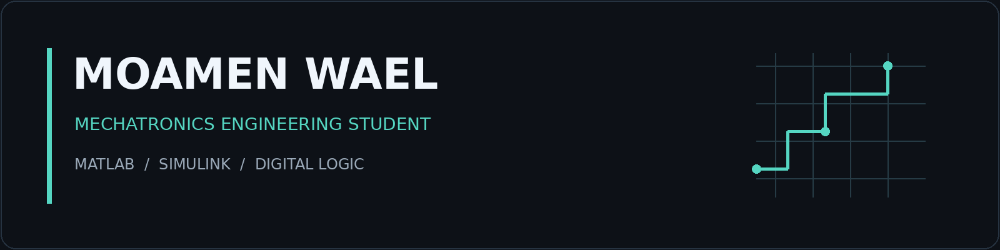

# Moamen Wael

Mechatronics Engineering Student at the Egyptian Academy for Engineering and Advanced Technology (EAEAT), affiliated with the Ministry of Military Production.

My project work includes digital logic hardware, Proteus circuit simulation, and Simulink models.

## Selected project work

| Project | Work completed | Tools |
| :--- | :--- | :--- |
| **BCD Adder / Subtractor** | Hardware implementation and circuit simulation | Proteus |
| **Smart Container** | Simulation model | Simulink |
| **Line Follower Race Car** | Simulation model, with MATLAB used to define constants | Simulink, MATLAB |

## Technical skills

- **Modeling and simulation:** MATLAB, Simulink
- **Circuit simulation:** Proteus
- **Programming:** C, academic coursework
- **CAD:** SolidWorks, basic level

## Contact

- **Email:** [moamenwael002@gmail.com](mailto:moamenwael002@gmail.com)
- **LinkedIn:** [Moamen Wael](https://www.linkedin.com/in/moamen-wael-b04724335)
- **Phone:** +20 120 846 5082
